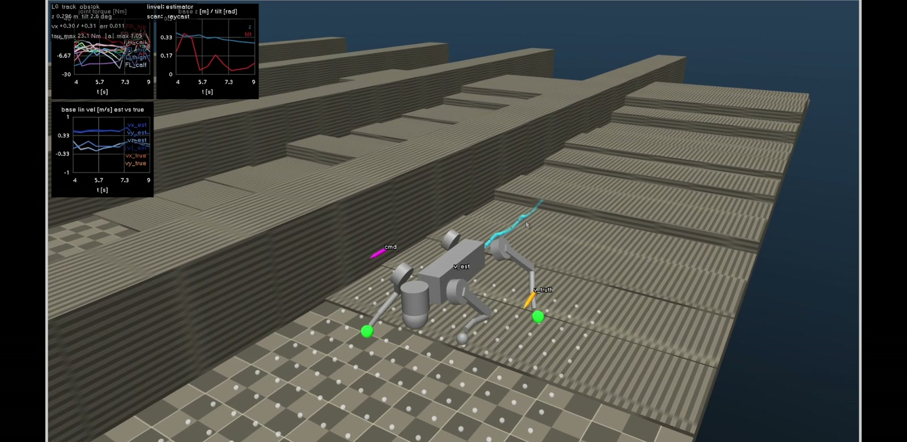
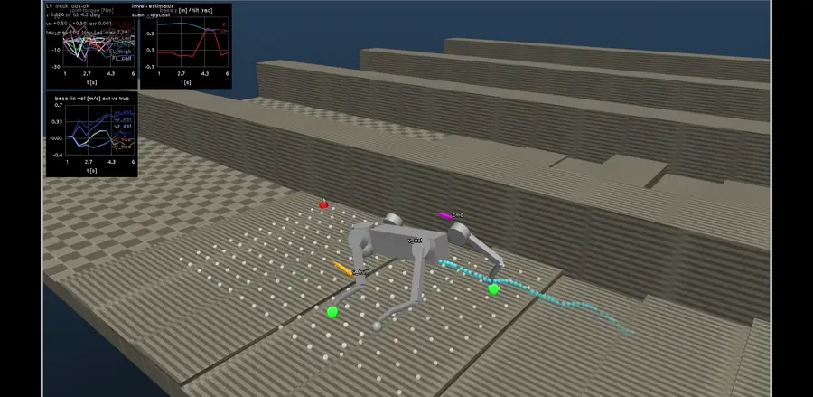
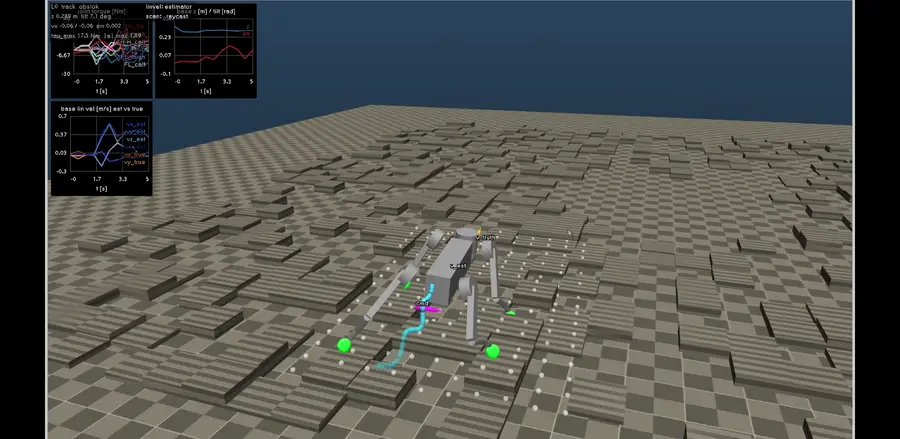
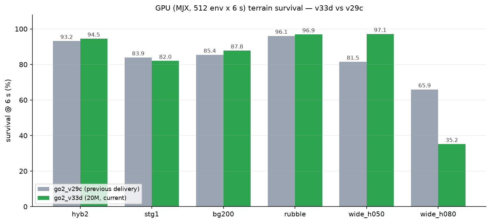
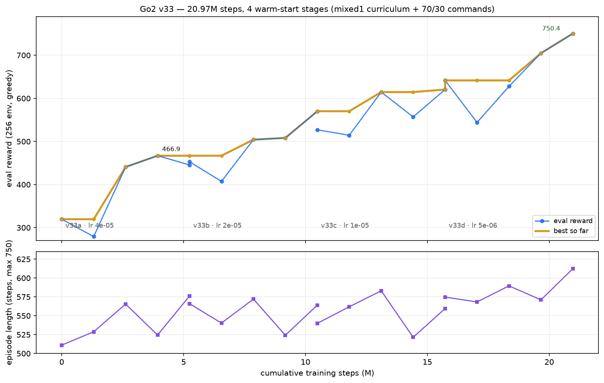

<div align="center">

# MJX Go2 Training

**Unitree Go2 复杂地形行走策略 —— MJX (MuJoCo Warp) + Brax PPO 全流程训练工程**

[](https://www.python.org/)
[](https://github.com/jax-ml/jax)
[](https://github.com/google-deepmind/mujoco)
[](https://github.com/google/brax)
[](https://github.com/NVIDIA/warp)
[](LICENSE)
[](https://github.com/TC635807/mjx-go2-mujoco2ros2)

**20.97M 步训练 · 1536–768 MLP · 243 维观测 · 单张 8 GB 笔记本 GPU · 导出到 [部署仓](https://github.com/TC635807/mjx-go2-mujoco2ros2)**



<sub>mixed1 混合地形课程：台阶 / 离散箱体 / 碎石；观察器叠加高度扫描点、速度估计与指令箭头</sub>

</div>

---

> 本仓只做**训练与实验**：环境、PPO、地形生成、评测、策略导出。
> 加载训练好的策略做 MuJoCo 仿真、ROS 2 / DDS 真机部署，在姊妹仓
> [**mjx-go2-mujoco2ros2**](https://github.com/TC635807/mjx-go2-mujoco2ros2)。
> 上图的策略就是在本仓训练、导出成 **286 KB 的纯 numpy npz** 后，在部署仓的 CPU MuJoCo 闭环里跑出来的。

<a id="toc"></a>

## 📋 目录

- [亮点](#highlights)
- [演示](#demo)
- [结果](#results)：[台阶能力](#stairs) · [地形存活](#survival) · [部署侧闭环](#cpu) · [训练曲线](#curve)
- [环境模型](#env)：观测 / 动作 / 奖励 / 地形 / 课程 / 域随机化
- [快速开始](#quickstart)：安装 · 训练 · 评测 · 导出
- [仓库结构](#layout) · [文档](#docs) · [与部署仓的关系](#deploy-repo)
- [踩过的坑](#lessons) · [许可](#license)

<a id="highlights"></a>

## ✨ 亮点

- **单卡可复现**：RTX 5060 Laptop（8 GB）+ WSL2，2048 个并行环境、约 **3.2k steps/s**；
  20.97M 步四段式课程训练共 **约 1 小时 50 分**（每段 5.24M 步 / 27 分钟）。
- **复杂地形课程**：49 个训练场景（真竖面台阶 / 箱体 / 碎石 + hfield 起伏 / 斜坡 / 混合），
  `mixed1` 是 5 条隔离赛道组成的 per-env 自适应课程（promote/demote 阈值 3.5 m / 1.2 m）。
- **台阶能力可用**：真竖面台阶 0.03 m 上两级 **98.4%**、0.05 m 上两级 **82.8%（存活 95.3%）**，
  0.08 m 仍能上 **34%**（Go2 的物理上限约 0.10 m）。
- **训练/部署同源**：观测、执行器、物理参数逐项对账（见部署仓 `verify_train_deploy_obs.py` /
  `verify_train_deploy_parity.py`），导出的 npz 在 CPU MuJoCo 闭环里 **48 seed 总存活 86.7%**。
- **可审计的实验史**：v1 → v33 每一轮的正/负结果、口径、复现命令都在 `docs/`，
  训练日志与评测 TSV 在 `logs/`，**不挑好看的数**：部署侧 hyb2 回退等负结果同样记录在案。
- **策略即产物**：`policies/go2_walk_v33d.pkl` → 部署仓 `go2_walk_v33d.npz`（1536-768，
  1.56M 参数，单次推理约 3.1 MFLOPs），不需要 JAX 就能在机器人上跑。

<a id="demo"></a>

## 🎬 演示

> 素材来自 [部署仓](https://github.com/TC635807/mjx-go2-mujoco2ros2) 的观察器，策略为 v33d。
> 画面里的白色小球是**观察器真值 raycast**（用于对照），不是策略输入；策略输入是
> SimLidar + HeightMapper 生成的 187 点高度扫描。

<table>
<tr>
<td width="50%"><br/><sub><b>mixed1 台阶赛道</b>：0.02–0.10 m riser 的连续台阶，策略直接踩上去</sub></td>
<td width="50%"><br/><sub><b>big1 / 碎石场</b>：离散竖面箱体 + 1–7 cm 碎石，靠高度扫描感知落脚点</sub></td>
</tr>
</table>

完整演示（70 s，720p，含台阶 / 箱体 / 碎石 / 平地）：

▶ [docs/assets/go2_v33d_demo_720p.mp4](docs/assets/go2_v33d_demo_720p.mp4)

<a id="results"></a>

## 📊 结果

所有数字都可复现；口径差异（384 vs 512 env、warp vs CPU MuJoCo）在 `docs/go2-eval-harness.md` 里写清楚了。

<a id="stairs"></a>

### 1. 台阶能力阶梯（真竖面碰撞，128 env × 300 步）

| 地形 | riser | 指标 | `go2_v29c`（上一交付） | **`go2_v33d`（当前交付）** |
|---|---|---|---|---|
| `wide_h030` | 0.03 m | 上 1 级 / 上 2 级 / 存活 | 84.7% / 15.3% / 96.9% | **100% / 98.4%** / 96.1% |
| `wide_h050` | 0.05 m | 上 1 级 / 上 2 级 / 存活 | 42.3% / 0% / 75.8% | **100% / 82.8% / 95.3%** |
| `wide_h080` | 0.08 m | 上 1 级 / 上 2 级 / 存活 | 0% / 0% / 72.7% | **34.0% / 10.6%** / 36.7% |
| `lanes1` | 0.03–0.11 m | 上 2 级 | 14.1% | **99.0%** |

> `wide_h080` 的代价要说清楚：v33d 更激进，6 s 内 35.2% 存活（v29c 65.9%）——
> 它能上 0.08 m，但也会因为冲得太猛摔下来。0.05 m 这一档同时拿到「83% 上两级 + 95% 存活」，
> 是这轮最实在的收益。

<a id="survival"></a>

### 2. 地形存活（MJX 512 env × 6 s，`logs/v33_sweep.tsv`）

| 地形 | `go2_v29c` | **`go2_v33d`** |
|---|---|---|
| `hyb2`（3×3 混合，最常用的回归地形） | 93.2% | **94.5%** |
| `stg1`（真竖面楼梯 0.06/0.11 m） | 83.9% | 82.0%（噪声内） |
| `bg200`（20×20 箱体场） | 85.4% | **87.8%** |
| `rubble`（519 块碎石） | 96.1% | **96.9%** |
| `wide_h050`（0.05 m 通宽楼梯） | 81.5% | **97.1%** |
| `wide_h080`（0.08 m，能力边界） | **65.9%** | 35.2%（更激进，见上） |



<a id="cpu"></a>

### 3. 部署侧闭环（CPU MuJoCo，48 seed，双轨验收的另一轨）

| 指标 | `go2_v29c` | `go2_v32b` | **`go2_v33d`** |
|---|---|---|---|
| 总存活 | **87.5%** | 83.3% | 86.7%（噪声内） |
| 平均速度 | 0.291 m/s | 0.340 m/s | **0.323 m/s** |
| 平均位移 | 3.72 m | 4.45 m | **4.23 m** |
| 髋关节 q p95（4 髋） | 43.5/40.8/37.8/41.4° | 44.5/34.4/30.7/41.6° | **44.4/29.7/26.2/40.8°** |
| CPU 分地形：hyb2 / stg1 / big1 / rubble | **91.7 / 68.8 / 87.5** / 89.6% | 70.8 / 68.8 / 79.2 / 97.9% | 81.2 / **72.9** / 79.2 / **100.0%** |

> 这是训练仓和部署仓**必须同时看**的数据：v24/v25a 曾经「仿真强、部署绕圈」。
> v33d 在 warp 地形上全面 ≥ v29c，但 CPU 全命令 `hyb2` 81.2%（v29c 91.7%）与
> `big1` 79.2%（87.5%）略低——所以 v29c 保留为回退档，而不是删掉。

<a id="curve"></a>

### 4. 训练曲线：20.97M 步，四段 warm-start + lr 阶梯衰减



| 段 | 步数 | lr | best eval_reward | eval ep_len |
|---|---|---|---|---|
| `v33a` | 5.24M | 4e-5 | 466.9 (@3.93M) | 576 |
| `v33b` | 5.24M | 2e-5 | 570.2 (@5.24M) | 564 |
| `v33c` | 5.24M | 1e-5 | 620.5 (@5.24M) | 559 |
| `v33d` | 5.24M | 5e-6 | **750.4 (@5.24M)** | **612** |

> [!IMPORTANT]
> **「训练越久越好」不成立。** 恒定 lr 时 v31b/v31c 在 3–5M 步后回落；本轮能持续涨，是因为
> **课程持续变难 + 命令分布变宽（70% 前向 / 30% 全向）+ lr 阶梯衰减** 同时满足。
> Go1 的 60M 步是不同任务/算法/步数定义，不能直接类比。若要继续，建议用同样方式续到 40M
> 并把 lr 再降一档，而不是无脑堆步数。详见 `docs/go2-v32-mixed-curriculum.md §5`。

<a id="env"></a>

## 🧠 环境模型

一个步长为 `0.002 s`、控制周期 `0.02 s`（50 Hz）、episode 15 s（750 步）的 MJX 环境，
定义在 [`envs/go2_walk.py`](envs/go2_walk.py)。

### 观测（actor 243 维 / critic 314 维）

| 段 | 维度 | 内容 | 缩放 |
|---|---|---|---|
| `0:3` | 3 | 机体系基座线速度 | ×2.0 |
| `3:6` | 3 | 基座角速度 | ×0.25 |
| `6:9` | 3 | projected gravity | ×1.0 |
| `9:12` | 3 | 速度指令（机体系） | ×2.0 |
| `12:24` | 12 | 关节位置 − home | ×1.0 |
| `24:36` | 12 | 关节速度 | ×1.0 |
| `36:48` | 12 | 上一帧动作 | ×1.0 |
| `48:235` | 187 | 高度扫描：17×11 网格，x ∈ [−0.4, 1.2] m，y ∈ [−0.5, 0.5] m，`clip(z_base − h − 0.268, ±0.35) × 5` | ×1.0 |
| `235:243` | 8 | trot 相位（4 腿 × sin/cos），1.8 Hz | ×1.0 |

高度扫描带 **LiDAR 遮挡模型**：4 点采样、视场限制、自遮挡、5% dropout、遮挡召回 50%，
actor 的扫描有盲区/空洞，critic 仍拿完美扫描 —— 这是策略在部署侧「扫描点不会穿墙」的关键。

### 动作

12 个**绝对关节位置目标**（顺序 FR, FL, RR, RL × hip, thigh, calf），直接 clamp 到
MuJoCo `ctrlrange`；训练时再内缩 5%（软关节范围）。

### 奖励与课程

- **跟踪类**：线速度 / 角速度跟踪、`forward_progress`、`lazy_stop`
- **步态类**：`feet_phase`（对角 trot 相位）、`feet_height`、`feet_clearance`、`feet_slip`、
  `feet_impact`、`feet_dangle`、`symmetry`
- **姿态/平滑类**：`base_height`、`orientation`、`action_rate`、`action_acc`、
  `hip_action`（四髋偏离 home 的平方和，v28 起压制髋摆幅）
- **爬升类**：`ascent`（相对出生点每步爬升，权重 2.0，逼策略走上去而不是绕开）
- **终止类**：`termination` 惩罚、非足端深穿透终止（`terminate_body_pen`）
- **课程**：`mixed1` 每条赛道 1 个难度等级（0–4）；`dist > 3.5 m` 且未摔 → promote，
  摔倒或 `dist < 1.2 m` → demote，初始等级 2。实现见 [`sim/brax_curriculum.py`](sim/brax_curriculum.py)

### 地形与域随机化

- **49 个训练场景**：`mixed1`、`big1`（5×5 大混合）、`hyb1/2/3`、`rubble`（519 块 1–7 cm 碎石）、
  `bg200`（20×20 箱体场）、`stg1`、`wide_h020…h140`（0.02–0.14 m 通宽楼梯）、`bands_u006…022`、
  `stairs1/2`、hfield 系列（`mix` / `slope_only` / `rough_only` …）。
- **真竖面碰撞 + hfield 视觉**：碰撞用 `group=4` 的 box/瓦片，渲染用统一材质的视觉网格，
  保证「看得见的高度 = 撞得到的高度 = 扫得到的高度」。
- **域随机化**：观测噪声、线速度估计误差（bias ±0.05 m/s、OU std 0.04、0–20 ms 延迟）、
  随机推力（每 250 步 ±0.5 m/s）、地形随机出生（xy ±5 m、随机 yaw、离地 0.32 m）、
  LiDAR 遮挡/空洞；训练后期在 warp 上使用硬接触（20/10 Newton 迭代）对齐部署物理。

<a id="quickstart"></a>

## 🚀 快速开始

### 安装

```bash
git clone https://github.com/TC635807/mjx-go2-training.git
cd mjx-go2-training
python -m venv .venv && source .venv/bin/activate
pip install -r requirements.txt --extra-index-url https://pypi.nvidia.com   # CUDA 12 的 jaxlib
```

> 仓库在 Python 3.14 / CUDA 12 / RTX 5060 Laptop（8 GB）/ WSL2 上验证。
> 没有 GPU 也能跑评测（`JAX_PLATFORMS=cpu`），训练需要 CUDA。

### 训练（v33d 配方）

```bash
# 0) 生成 mixed1 混合地形课程（5 条隔离赛道）——已有可跳过
python sim/gen_terrain_mixed_curriculum.py --prefix mixed1

# 1) 四段 warm-start；每段 5.24M 步、约 27 分钟（RTX 5060 Laptop）
#    第 1 段从 v32 的 best 热启动；后面每段 SRC 指向上一段的 checkpoints/best
TAG=v33d_20m SRC=models/go2_v33c_20m_logs/checkpoints/best \
  SCENE=models/go2/scene_mjx_terrain_mixed1.xml BOXGRID=models/go2/assets/mixed1.json \
  CONTACT=clearance RING=0 SPAWN_STAIRS=0 STEPS=5242880 LR=5e-6 NUM_EVALS=5 \
  LAYERS=1536,768 VLAYERS=1536,768 ENVS=2048 NACON=49152 NJMAX=192 XLAFRAC=0.35 \
  HIPW=-0.3 ACTW=-0.01 SWING=0.18 ASCENT=2.0 ORIW=-2.5 PROGW=1.0 LAZYW=-1.5 TERMW=-20 \
  RFLOOR=-25 PHASEW=0.5 TBPEN=0.02 CLEARW=-0.7 CLEART=0.10 EP_LEN=750 FPROB=0.7 \
  CURRICULUM=1 CURINIT=2 CURSUCC=3.5 CURMIN=1.2 \
  bash sim/gpu_guard.sh run -- bash sim/run_go2_v28.sh
```

- `LR` 依次为 `4e-5 → 2e-5 → 1e-5 → 5e-6`；每段 5 次 eval 保留 `best/`。
- **所有训练/评测必须走 [`sim/gpu_guard.sh`](sim/gpu_guard.sh)**：本机是 8 GB 笔记本 GPU 且与
  WSLg 桌面共享显存，并行两个作业会让 fps 掉一半以上甚至 OOM。`bash sim/gpu_guard.sh status`
  可查当前占用；拿不到锁时作业会直接拒绝启动（exit 3）。

### 评测

```bash
# 台阶能力阶梯（真竖面地形，128 env × 300 步）
python sim/eval_stairs_climb.py --pkl policies/go2_walk_v33d.pkl \
    --terrains wide_h030,wide_h050,wide_h080,lanes1 --envs 128 --steps 300

# 地形存活（MJX；512 env × 6 s，输出 TSV）
POLS="v33d=go2_v33d_20m_logs/checkpoints/best" ENVS=512 OUT=logs/my_sweep.tsv \
    bash sim/eval_vertical_vs_hfield.sh

# CPU MuJoCo 闭环（部署侧物理；48 seed）
python sim/eval_go2.py --pkl policies/go2_walk_v33d.pkl --seeds 48 \
    --terrain flat --steps 450
```

### 导出到部署仓

```bash
# orbax checkpoint -> pkl（训练仓）-> npz（部署仓，含 jax/numpy 等价性校验）
bash sim/export_deploy_policy.sh models/go2_v33d_20m_logs/checkpoints/best v33d
#   -> policies/go2_walk_v33d.pkl                       (本仓)
#   -> ../mjx-go2-mujoco2ros2/ros2_controller/policies/go2_walk_v33d.npz   (部署仓)

# 把训练地形导出成部署仓可直接加载的场景（31 个地形 + 视觉网格 + 清单）
python sim/export_deploy_terrains.py
```

<a id="layout"></a>

## 🗂 仓库结构

```text
mjx-go2-training/
├── envs/go2_walk.py              # 环境：观测 / 奖励 / 终止 / 地形 / LiDAR 遮挡 / 课程
├── train/train_go2.py            # Brax PPO 训练入口（全部旋钮都是 CLI）
├── sim/
│   ├── run_go2_v28.sh            # 训练启动器（TAG/SRC/SCENE/... 环境变量配方）
│   ├── brax_curriculum.py        # per-env 地形课程 wrapper（promote/demote）
│   ├── gen_terrain_*.py          # 49 个训练地形的生成脚本
│   ├── eval_stairs_climb.py      # 台阶能力阶梯
│   ├── eval_vertical_vs_hfield.sh / eval_rubble.sh / summarize_dual_suite.py
│   ├── eval_go2.py               # CPU MuJoCo 闭环（部署物理复刻）
│   ├── export_deploy_policy.sh   # ckpt -> pkl -> 部署 npz
│   ├── export_deploy_terrains.py # 训练地形 -> 部署场景/manifest
│   ├── widen_checkpoint.py       # net2wider：1024-512 -> 1536-768 精确等价扩展
│   └── gpu_guard.sh              # 单 GPU 作业串行锁
├── models/go2/                   # 地形资产：55 个 XML + 49 个 hfield/boxgrid + 机器人 mesh
├── models/go2_v33d_20m_logs/     # 本交付档的 orbax 检查点（best + 5M 间隔）
├── policies/go2_walk_v33d.pkl    # 交付策略参数（brax PPO，pickle）
├── logs/                         # 训练日志 + 评测 TSV（v33 全套可复现）
├── docs/                         # 实验记录（v1 -> v33）+ 评测口径 + 图片
└── requirements.txt
```

<a id="docs"></a>

## 📚 文档

| 文档 | 内容 |
|---|---|
| [`docs/go2-v32-mixed-curriculum.md`](docs/go2-v32-mixed-curriculum.md) | **v32/v33 混合地形课程 + 20M 长训练**（当前交付，含 v33d 验收与「越大越好吗」的回答） |
| [`docs/go2-v30-curriculum.md`](docs/go2-v30-curriculum.md) | per-env 地形课程实现、net2wider 大网络、部署 trade-off |
| [`docs/go2-v29-stairs.md`](docs/go2-v29-stairs.md) | 台阶能力专项、brax `full_reset` 修复、通宽楼梯与隔离赛道 |
| [`docs/go2-v28-stairs.md`](docs/go2-v28-stairs.md) | 髋摆幅/步态自然性/脚卡瓦缝三条反馈的根因实测 |
| [`docs/go2-v7-terrain.md`](docs/go2-v7-terrain.md) | v1 → v25 主实验记录（正/负结果与口径） |
| [`docs/go2-eval-harness.md`](docs/go2-eval-harness.md) | 评测口径（384 vs 512 env、warp vs CPU MuJoCo） |
| [`docs/go2-lidar-occlusion-survey.md`](docs/go2-lidar-occlusion-survey.md) | 高度扫描 / LiDAR 遮挡模型调研 |
| [`docs/go2-delivery.md`](docs/go2-delivery.md) | 交付说明与文件清单 |

<a id="deploy-repo"></a>

## 🧩 与部署仓的关系

两个仓**没有包级依赖**，耦合全部是「产物单向导出 + 同一契约在两仓各实现一次」：

| 方向 | 内容 | 落点 |
|---|---|---|
| 训练 → 部署 | 策略 `pkl → npz`（+ `.json` 元数据、`.equiv.npz` 等价回归） | `ros2_controller/policies/` |
| 训练 → 部署 | 31 个地形场景 XML + hfield PNG + 视觉 OBJ + `terrains.json` | `sim_env/models/go2/` |
| 训练 → 部署 | 机器人物理参数（`go2_mjx_position.xml` ↔ 部署 `go2.xml` + PD） | 双轨对账脚本 |
| 部署 → 训练 | 审计脚本回读训练仓（`eval_go2.py`、训练 XML/pkl） | `scripts/verify_train_deploy_obs.py` 等 |

部署仓 `scripts/view_policy.py` 的 3D 观察器、`tests/test_terrain_scenes.py` 的地形契约测试，
都消费本仓导出的资产。

<a id="lessons"></a>

## 🕳 踩过的坑

- **选检查点看地形存活率，不看 eval_reward。** 多次观察到 reward 涨、生存跌。
- **brax 默认 `full_reset=False`**：每个 env 整个训练只回放同一个初始状态，地形/姿态多样性
  会被吃掉——必须 `--full_reset`。
- **warp 的 `naconmax` / `njmax` 溢出是静默退化**（丢接触、NaN 打爆参数），不是警告：
  2048 env 用 `naconmax=49152`、`njmax=192`。
- **net2wider 只缩放输出侧权重**：先缩放再 tanh 会把策略直接打废（实测 eval −1008）。
- **brax `checkpoint.load_config` 的 `KERNEL_INITIALIZER[None]` bug**：手动读 json 恢复网络配置。
- **课程 wrapper 与 brax logger 的字段契约**：`truncation` / `episode_done` / `episode_metrics`
  必须从 `nstate` 带回，否则 `ep_len` 永远是 0。
- **384 env 的 1–2 pp 差异不可靠**，交付决策用 512 env 同进程对比。
- **评测必须双轨**：warp 地形存活 + 部署仓 CPU MuJoCo 闭环，二者不一致过（v24/v25a）。

<a id="license"></a>

## 📜 许可与致谢

MIT License © 2026 TC635807，见 [LICENSE](LICENSE)。

环境与训练栈参考了 [MuJoCo Playground](https://github.com/google-deepmind/mujoco_playground)、
[Brax](https://github.com/google/brax)、[mjlab](https://github.com/mujocolab/mjlab)、
[legged_gym / IsaacLab](https://github.com/leggedrobotics/legged_gym)、
[unitree_mujoco](https://github.com/unitreerobotics/unitree_mujoco) 与
[go2_omniverse](https://github.com/abizovnuralem/go2_omniverse) 的公开配方；
Go2 模型来自 [mujoco_menagerie](https://github.com/google-deepmind/mujoco_menagerie)。

如果这个项目对你有帮助，欢迎 ⭐ Star 或提 Issue 讨论训练配方。
