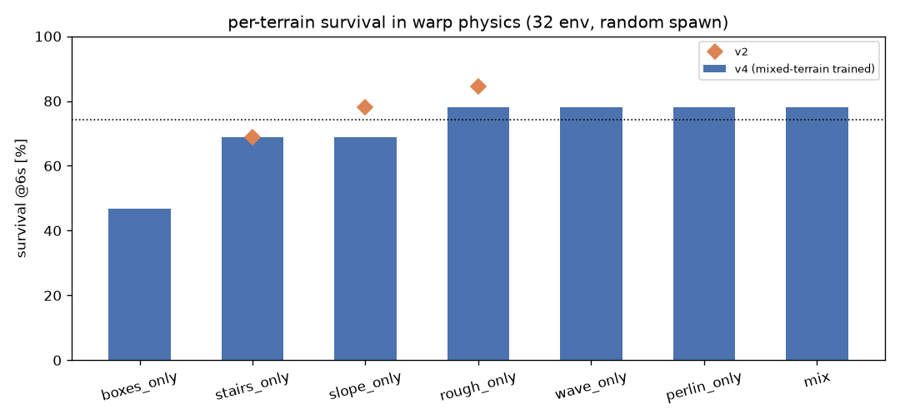

# 如何加强 Go2 的台阶/斜坡/凹凸地形鲁棒性 —— 开源做法调研 + 我们的方案

> 问题: 要提升台阶/斜坡/凹凸地面的稳定行走, 是"用更复杂的地形", 还是"找全是台阶/全是斜坡
> 的地形做专项训练"?
>
> 结论先行: **开源界几乎不"只训单一地形"**. 通行做法是
> **① 混合地形 + 按比例加权 (台阶权重最高)**、**② 难度分档 + 地形课程**、
> **③ 足够大的高度扫描 (官方 Go2 是 1.6m x 1.0m @ 0.1m = 187 点)**。
> 专项地形集 (mjlab 的 STAIRS_TERRAINS_CFG) 也是"多难度台阶混合", 不是单一种类。
> 我们已按这个方向启动 v5 (两段式课程 + 扫描放大到 17x11)。



---

## 1. 开源实现怎么做的 (带出处)

### 1.1 legged_gym (ETH, 四足 RL 事实标准)

```python
class terrain:
    mesh_type = 'trimesh'; curriculum = True
    terrain_length, terrain_width = 8., 8.
    num_rows = 10          # 难度等级
    num_cols = 20          # 地形类型列
    max_init_terrain_level = 5
    terrain_proportions = [0.1, 0.1, 0.35, 0.25, 0.2]
    # [smooth slope, rough slope, stairs up, stairs down, discrete]
    measured_points_x = [-0.8 ... 0.8]   # 17 点
    measured_points_y = [-0.5 ... 0.5]   # 11 点 -> 187 点, 1.6m x 1.0m, 0.1m 间距
```

* **台阶占 60%** (stairs up 35% + stairs down 25%), 斜坡 20%, 离散块 20%;
* 课程: `curriculum=True`, 行=难度, 每 8m patch 一个; 机器人走够远就升难度;
* 高度扫描 187 点 / 1.6x1.0m —— 比我们的 35 点 / 1.2x0.8m 密 2 倍、范围大 2.7 倍。

### 1.2 mjlab + unitree_rl_mjlab (MuJoCo, 官方 Go2 任务)

* `ROUGH_TERRAINS_CFG`: flat 20% / **金字塔台阶 20% / 倒台阶 20%** /
  斜坡 10%+10% / random_rough 10% / wave 10%; 8m patch, 10 行(难度) x 类型列,
  `curriculum=True`, `max_init_terrain_level=5`.
* 另有**专项地形集** `STAIRS_TERRAINS_CFG`:
  **flat 25% + easy stairs 35% (2-5cm) + moderate 25% (5-8cm) + challenging 15% (8-10cm)**
  —— 注意它仍然是"多难度混合", 不是只有台阶。
* 课程更新逻辑 (unitree `terrain_levels_vel`):
  走过的距离 > patch 半边长 → 升级; 距离 < 指令速度×episode 时长×0.5 → 降级; 然后更新 env 起点。
* **高度扫描**: `RayCastSensorCfg(pattern=GridPatternCfg(size=(1.6, 1.0), resolution=0.1), ray_alignment="yaw")`
  = **187 点, 0.1m 间距, yaw 对齐** —— 和 legged_gym 一个量级。

### 1.3 IsaacLab ROUGH_TERRAINS_CFG

pyramid stairs 20% + inverted 20% + boxes 20% + random rough 20% + slopes 10%+10%;
8m patch, 10x20 网格, horizontal_scale 0.1m。

### 1.4 MuJoCo Playground (Go1 rough) —— 对照

静态 hfield, 20m x 20m, **只有 5cm 白噪声起伏**, 无台阶/斜坡, 且不给高度扫描 ——
这是"最弱"的 rough 参考, 说明只靠小幅噪声学不会台阶。

---

## 2. 我们的现状与诊断 (实测)

### 2.1 感知: 扫描比官方 Go2 稀疏 4.6 倍

| | 我们 (v1-v4) | mjlab/unitree Go2 | legged_gym |
|---|---|---|---|
| 点数 | 7x5 = **35** | 16x10 = 160 (1.6x1.0m @0.1) | 17x11 = **187** |
| 覆盖 | x[-0.3,0.9] y[-0.4,0.4] = 1.2x0.8m | 1.6x1.0m | 1.6x1.0m |
| 间距 | 0.2m | 0.1m | 0.1m |

台阶宽 0.3m 时, 0.2m 间距只能采到 1-2 个点, 很难分辨台阶边缘; 0.1m 间距能采到 3 个点。

### 2.2 地形: 训练图偏"缓"

v4 的混合图 (n=128): 90% 区域 <=9.2cm, 平均 4.4cm, 台阶 patch 只有 2/8 块且 <=20cm。
对比 legged_gym 台阶占 60%、mjlab 台阶占 40%。

### 2.3 per-terrain-type 实测 (v4, warp 训练物理, 随机出生 32 env x 6s)

| 地形 | v4 存活 | v2 存活 |
|---|---|---|
| **boxes_only (随机方块)** | **46.9%** | — |
| **stairs_only** | **68.8%** | 68.8% |
| **slope_only** | **68.8%** | 78.1% |
| rough_only | 78.1% | 84.4% |
| wave_only | 78.1% | — |
| perlin_only | 78.1% | — |
| mix (混合) | 78.1% | — |

结论: **台阶/斜坡/方块是最弱的三类** (68.8%/68.8%/46.9%), 而 v4 (混合地形训练) 相比 v2
在这些专项上没有提升 —— 说明 v4 的地形图"多样性"够但"难度和感知"不够。

---

## 3. 我们的方案: 不训单一地形, 做"加权混合 + 宏观课程 + 放大扫描"

单类型专项训练的问题: ①灾难性遗忘 (只训台阶会丢掉斜坡/平地); ②过拟合该地形的统计特征;
③开源也不这么做 (mjlab 的"专项"仍是多难度混合)。单类型地形图的正确用途是**评测与诊断**
(我们已经生成 stairs_only / slope_only / rough_only / boxes_only / wave_only / perlin_only)。

### v5 (已启动, sim/run_go2_v5_curriculum.sh): 两段式宏观课程

我们受限于 brax/MJX warp 的"单张共享 hfield", 没有 per-env 地形, 无法做逐机器人课程;
用**两段式宏观课程**近似 (全体环境一起升级难度):

| 阶段 | 步数 | 地形 | 目的 |
|---|---|---|---|
| A | 20M | mix (n=128) | 重建带新扫描的基础行走能力 |
| B | 20M | **v5 地形**: 台阶 4 块 / 斜坡 3 块 / 起伏 1 / 平地 1, 硬度 1.5 (台阶 ~12-24cm, 斜坡 ~20°) | 台阶/斜坡专项强化 |

同时把高度扫描从 35 点换成 **17x11=187 点 (1.6x1.0m, 0.1m 间距)**, 与官方 Go2 对齐
(obs 91 -> 243, critic 162 -> 314; 需要从零训练, 不能续 v4)。

Stage B 之后自动跑: 平地 CPU 评测 + per-type warp 评测 (v5 vs v4 同图同口径)。

### 预期与后继

* 目标: stairs/slope >= 80%, boxes >= 65%, mix >= 85%, 平地不掉 (>=95% 存活、vx 0.5±10%)。
* 若台阶仍 <75%: v6 候选 (按代价排序)
  1. 扫描再加到 0.15m 间距 / 2.0x1.2m 范围 (obs 更大, 从零训练);
  2. 地形再分一段: 第三段 v6 地形 (台阶 ~30cm, 斜坡 ~30°, 方块 20cm), 比例更向台阶倾斜 (参考 60%);
  3. 奖励: 抬脚高度/落脚点塑形 (足端落在台阶面上的奖励), 或对"踩空/绊到竖壁"加惩罚;
  4. **R1 (warp <-> CPU hfield 接触差异)**: 不解决则地形能力无法在 CPU/真机侧验收。
* 单类型地形集保留用于**验收**: 每版策略都要过 per-type 表, 而不是只看混合地形整体存活。

---

## 4. 复现

```bash
cd mjx-go1-getup

# 生成所有地形 (混合 + 6 种单类型, n=128)
for p in mix v5 stairs_only slope_only rough_only boxes_only wave_only perlin_only; do
  /home/tc63/mujoco/.venv/bin/python sim/gen_terrain_go2_mix.py --n 128 --preset $p --seed 1 --out_prefix terrain_$p
done

# v5 两段课程 (约 2.6h) + 自动评测
bash sim/run_go2_v5_curriculum.sh

# 单独跑 per-type 评测 (任意策略)
for t in stairs slope rough boxes; do
  XLA_PYTHON_CLIENT_PREALLOCATE=false XLA_PYTHON_CLIENT_MEM_FRACTION=0.4 \
    /home/tc63/mujoco/.venv/bin/python sim/probe_go2_warp_eval.py \
    --policy policies/go2_walk_v5.pkl --envs 32 --steps 300 --spawn random \
    --cmd 0.5 0 0 --foot-contact hard \
    --terrain_xml models/go2/scene_mjx_terrain_$(t)_only.xml
done
```

## 5. 开源链接

* legged_gym: <https://github.com/leggedrobotics/legged_gym>
  (terrain 配置在 `legged_gym/envs/base/legged_robot_config.py`)
* mjlab: <https://github.com/mujocolab/mjlab>
  (`src/mjlab/terrains/config.py` 的 ROUGH_TERRAINS_CFG / STAIRS_TERRAINS_CFG;
  `src/mjlab/sensor` 的 RayCastSensor + GridPatternCfg)
* unitree_rl_mjlab (官方 Go2): <https://github.com/unitreerobotics/unitree_rl_mjlab>
  (`src/tasks/velocity/mdp/curriculums.py` 的 terrain_levels_vel)
* IsaacLab terrain: <https://github.com/isaac-sim/IsaacLab>
  (`isaaclab/terrains/config/rough.py`)
* MuJoCo Playground: <https://github.com/google-deepmind/mujoco_playground>
  (`_src/locomotion/go1/xmls/scene_mjx_feetonly_rough_terrain.xml`)
