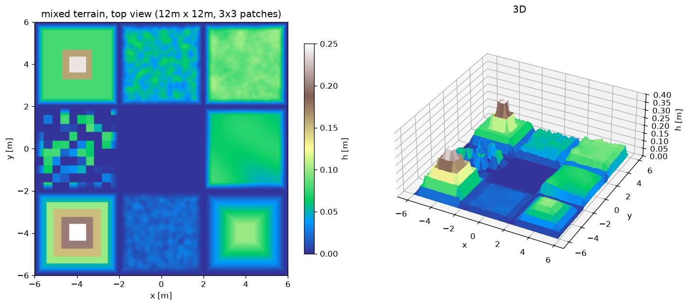

# Go2 四足地形调研 —— 有哪些现成地形/生成器，哪个适合我们

> 背景: 现有训练地形 (models/go2/assets/terrain.png) 是**一整张固定地图**:
> 平滑起伏 5cm + 6 块 6cm 台地 + 2 条 5 级楼梯 (最高 30cm), 12m×12m, 128×128。
> 问题: ①只有一张图, 策略可以背下来; ②格距 9.4cm 对 2.2cm 足端偏粗
> (CPU vs warp 的 hfield 接触分歧, 见 docs/go2-delivery.md §2.3)。
>
> 本文档: 调研现有开源地形方案 + 我们已落地的改动与实测。
> 结论: 不用换框架, 把 **mjlab (MuJoCo Warp) 的 ROUGH_TERRAINS 配方**搬成
> 一张 hfield 即可 —— 已实现 (`sim/gen_terrain_go2_mix.py`), 无需改训练代码,
> 用 `--terrain_xml models/go2/scene_mjx_terrain_mix.xml` 就能训。

---

## 1. 候选方案 (按与我们技术栈的匹配度排序)

### 1.1 mjlab 地形生成器 —— **最匹配** (MuJoCo Warp, Unitree 官方 Go2 在用)

* 仓库: <https://github.com/mujocolab/mjlab>
* 地形代码: `src/mjlab/terrains/` (`config.py` / `heightfield_terrains.py` / `primitive_terrains.py` / `terrain_generator.py`)
* 官方 Unitree Go2 任务: <https://github.com/unitreerobotics/unitree_rl_mjlab>
  (`src/tasks/velocity/config/go2/env_cfgs.py` 里 `TerrainType = Literal["rough", "obstacles"]`)
* 关键点 (与我们是同一套思路):
  - `ROUGH_TERRAINS_CFG`: 8m×8m patch, 10 行 × 20 列, **按 patch 拼多种子地形**,
    行 = 难度 (curriculum), 列 = 地形类型;
  - 子地形: `flat` 20% / `pyramid_stairs` 20% / `inverted` 20% / `hf_pyramid_slope` 10% / `inv` 10% / `random_rough` 10% / `wave` 10%;
  - 高度观测: `RayCastSensorCfg(name="terrain_scan")` + `height_scan` 观测项
    —— **和我们的 35 维 height_scan 语义相同**;
  - 课程: `terrain_levels_vel` (走够远就换更高难度 patch);
  - 事件: `randomize_terrain`。
* 地形类型清单 (取自官方 gallery): box_flat / box_pyramid_stairs / box_inverted_pyramid_stairs /
  box_open_stairs / box_random_stairs / box_random_grid / box_random_spread / box_tilted_grid /
  box_narrow_beams / box_stepping_stones / box_nested_rings / hf_pyramid_slope /
  hf_perlin_noise / hf_random_uniform / hf_wave / hf_discrete_obstacles.
* 为什么不能直接 pip 用: mjlab 是 **torch + mujoco_warp** 技术栈, 我们是 **jax + MJX(brax)**。
  但它的地形**设计参数**是可以直接搬的 (见 §2)。

### 1.2 MuJoCo Playground 的 Go1 rough terrain —— 现成 hfield.png, 同生态

* 仓库: <https://github.com/google-deepmind/mujoco_playground>
* 场景: `_src/locomotion/go1/xmls/scene_mjx_feetonly_rough_terrain.xml`:
  `<hfield name="hfield" file="assets/hfield.png" size="10 10 .05 1.0"/>`
  → **20m × 20m, 高度只有 5cm, 256×256 (格距 7.8cm)**;
* 地形图本体 (可直接下载): <https://raw.githubusercontent.com/google-deepmind/mujoco_playground/main/mujoco_playground/_src/locomotion/go1/xmls/assets/hfield.png>
* 实测这张图: 灰度值在 [0,1] 近似**均匀白噪声** (mean 0.497, std 0.289,
  相邻格平均高差 16.7mm) —— 即"碎石/随机凹凸"场, **没有台阶/斜坡/沟**。
* 训练配方: `Go1JoystickRoughTerrain`, 只给本体感觉 (没有高度扫描!),
  靠 5cm 的低幅随机起伏练鲁棒性; `naconmax=8*8192`, `njmax=60`
  (我们的 `8*8192` 就是从 Go1 这条继承的)。
* 结论: **"效果好"的官方 rough 其实很温和** (5cm 白噪声), 不是我们这种 30cm 楼梯。
  如果目标是"复杂地形稳定行走", 它是下限参照, 不是上限。

### 1.3 IsaacLab / legged_gym 的 terrain_generator —— 配方来源

* `legged_gym`: 四足 RL 事实标准, 子地形类型 (stairs / slope / rough / discrete) + curriculum
  <https://github.com/leggedrobotics/legged_gym>
* `IsaacLab` `ROUGH_TERRAINS_CFG` (2024-2025 主流配方):
  <https://github.com/isaac-sim/IsaacLab/blob/main/source/isaaclab/isaaclab/terrains/config/rough.py>

  | 子地形 | 占比 | 参数 |
  |---|---|---|
  | pyramid_stairs | 20% | 台阶 5–23cm, 宽 30cm |
  | inverted pyramid_stairs | 20% | 同上, 向下 |
  | boxes (random grid) | 20% | 格 45cm, 高 5–20cm |
  | random_rough | 20% | 噪声 2–10cm |
  | pyramid_slope (上/下) | 10%+10% | 坡度 0–0.4 |

  注意: IsaacLab 用 **trimesh** 拼地形 (每个 patch 一个 mesh), 我们只能用 **hfield**
  (训练环境的 35 维 height_scan 直接读 hfield_data, 且 warp 对 mesh 支持没验证过),
  所以移植时要把"垂直墙"降级成 hfield 能表达的形状 (见 §2 的差异说明)。

### 1.4 其它 (了解即可)

* **OrcaGym** 地形工具 (中文文档): <https://openverse-orca.github.io/OrcaGym/tutorial/tools/terrain-tools/>
* **UniLab** 高度场导入: <https://unilabsim.github.io/UniLab-doc/zh_CN/2-user_guide/6-terrain/2-heightfield_import.html>
* **genesis_playground**: <https://github.com/lgleim/genesis_playground>
* **lucidsim** (视觉 parkour, 生成式地形图片): <https://github.com/lucidsim/lucidsim>
  —— 视觉导航用, 与我们的 height_scan 状态观测不匹配。

---

## 2. 我们做了什么 (已落地)

`sim/gen_terrain_go2_mix.py` —— 把上面 1.1/1.3 的配方用 numpy 重写成**一张 hfield**:

* 12m×12m, 3×3 个 4m patch, 中心 patch = flat (原点 reset 一致);
* 8 种地形: 金字塔台阶 (两档)、金字塔斜坡 (两档)、随机起伏、正弦波、随机方块、Perlin 噪声;
* 所有 patch 边缘 0.45m 过渡到 h=0 (避免 patch 之间出现垂直墙把机器人绊倒);
* 分辨率 `--n 256` = **格距 4.7cm** (原来 9.4cm), 用来验证"提高分辨率能否缓解
  CPU/warp hfield 接触分歧";
* 输出: `models/go2/assets/terrain_mix.png` + `terrain_mix.json` +
  `models/go2/scene_mjx_terrain_mix.xml`;
* 训练入口 (新增):
  ```bash
  bash sim/start_go2_train.sh 40000000 \
      --terrain_xml models/go2/scene_mjx_terrain_mix.xml
  ```



### 2.1 生成结果

| 指标 | 值 |
|---|---|
| 高度 | 0 … 0.25 m, mean 0.045 m |
| 高度分位 50/75/90/95% | 3.5 / 7.2 / 9.3 / 10.1 cm |
| 格间坡度 p90 / p99 / max | 0.105 / 0.726 / 1.77 (rise/run) |
| 平坦区 (h<1cm) 占比 | 41% (含 flat patch 与 patch 过渡带) |

### 2.2 验证 (全部实测, 不是估计)

| 检查 | 结果 |
|---|---|
| CPU MuJoCo 加载 | OK (`eval_go2 --xml models/go2/scene_mjx_terrain_mix.xml`) |
| 高度语义: `mj_ray` vs 生成器 H | 网格点上 max 0.95mm / p99 0.89mm (16bit 量化 + 顶点定位) |
| **接触溢出** (`height field collision overflow`, 每 geom-hfield 50 接触上限) | 4 轮 × 6s 闭环行走: **0 次** |
| warp 后端 (`mjx.put_model(impl="warp")`) | OK, 300 步无 NaN、无 broadphase overflow |
| 老策略 (v2, 在旧地形上训的) 在新地形 | 存活 75%, vx≈0 (预期: 未见过的新地形), 说明地形可走但需要重训 |
| `--terrain_xml` 全链路 (env 实例化 + reset + step) | OK: hfield 256x256, 出生 z=局部地形+0.32, height_scan 特征非零, 步进有限 |
| 外部高度图导入 (`sim/import_heightmap_png.py`) | OK: MuJoCo Playground 的 Go1 rough hfield.png (20m, 5cm) 导入成 12m 图后, `mj_ray` 对拍 <0.1mm |

> 注: 高度扫描采样器 (`envs/go2_walk.py::terrain_height`) 读 hfield_data 的坐标约定与
> 旧地形完全一致 (PNG 写出同样是 `flipud(H)`), 已用 `mj_ray` 对拍确认。

### 2.3 与 mjlab/IsaacLab 的差异 (诚实标注)

1. 我们只能输出 **hfield**: "倒金字塔台阶 / 负高度坑" 表达不了, 统一改成 h≥0 的
   "上坡-平台-下坡"; 真正的负地形需要 mesh 地形 (本仓库未验证 warp 的 mesh 接触)。
2. 我们**没有 per-env 地形** (warp 环境的 hfield 是全体共享的闭包常量), 所以没有 mjlab 的
   "按 env 分难度 + curriculum"; 折中方案是"一张图里拼 9 个 patch + 随机出生覆盖",
   以及**每次训练换一张图 (换 seed)** 来近似。
3. 台阶的垂直面在 hfield 里是 1 格宽的陡坡 (4.7cm 格距下 ~60-100°), 不是精确的垂直墙;
   这既是限制, 也是缓解 CPU/warp 分歧的方向 (格距从 9.4cm 减半)。

---

## 3. 结论与建议

1. **不需要引入新框架/新地形库**: mjlab 的配方已经搬过来了, 且保持"单张 hfield + 随机出生"
   的现有训练架构不变。
2. **优先做**: 用 `--terrain_xml models/go2/scene_mjx_terrain_mix.xml` 重训一版
   (与 v3 的速度估计误差一起), 观察"混合地形 + 4.7cm 格距"是否同时改善
   ①复杂地形通过率 ②warp↔CPU 的接触分歧。
3. **若还要更强**: 每次训练换一个 `--seed` (生成不同地形图), 训 2-3 段,
   在留出的地图上评测 —— 这是在没有 per-env 地形的条件下最接近"地形域随机化"的做法。
4. 参考基准: playground 的"官方 rough"只有 5cm; 我们的混合地形 90% 区域 ≤9.3cm、
   最高 25cm 且含台阶/斜坡 —— 难度已经高于公开的 Go1 rough 配方。

---

## 4. 复现

```bash
cd mjx-go1-getup

# 生成混合地形 (默认 n=256 -> 4.7cm 格距; 也可 --n 128 复现旧格距)
/home/tc63/mujoco/.venv/bin/python sim/gen_terrain_go2_mix.py --n 256 --preset mix --seed 1

# 看统计 (不写文件)
/home/tc63/mujoco/.venv/bin/python sim/gen_terrain_go2_mix.py --n 256 --dry_run

# CPU 下检查地形 (不占 GPU)
JAX_PLATFORMS=cpu /home/tc63/mujoco/.venv/bin/python sim/eval_go2.py \
    --policy none --dummy hold_home --xml models/go2/scene_mjx_terrain_mix.xml \
    --duration 5 --seeds 2

# 用混合地形训练 (地形 patch 布局见 terrain_mix.json)
bash sim/start_go2_train.sh 40000000 --terrain_xml models/go2/scene_mjx_terrain_mix.xml
```

---

## 5. 重要限制: warp 的 hfield 接触上限 (2026-10-18 实测)

第一次用 n=256 (4.7cm 格距) 的混合地形开 v4 训练, **~100 秒内出现 5973 次**
`height field collision overflow, number of collisions >= 50` — 超过上限的接触被**静默丢弃**,
等于物理退化, 训练立即中止 (该次 log: logs/go2_v4_train_aborted_overflow.log)。

原因 (读 vendored 源码 mujoco/mjx/third_party/mujoco_warp/_src/collision_convex.py:395-435):
warp 对每个 (凸 geom, hfield) 对, 会遍历该 geom AABB 覆盖的**整个子网格**, 为**每个格子**生成
2 个三角接触 (不是只给真正穿透的格子), 上限 `MJ_MAXCONPAIR = 50`。

Go2 躯干有一个碰撞 box `size="0.1881 0.04675 0.057"` (0.376 x 0.0935 x 0.114 m)。
摔倒/趴地时它的世界 AABB 随 yaw 旋转可到 ~0.4 x 0.4 m:
* n=256 (4.7cm): 最多 ~9x9 格 -> ~162 接触/对 -> 必然溢出
* n=192 (6.25cm): ~7x7 -> ~98, 仍超
* n=160 (7.5cm):  ~6x6 -> ~72, 仍超
* n=128 (9.4cm): 实际 ~4x2~5x5 格 -> 通常 <50; **实测: v1/v2/v3 全部训练日志 (数千万步,
  老地形 n=128) 中该警告 = 0 次**

CPU MuJoCo 没有这个现象 (它的 hfield 碰撞只生成真正需要的接触; 我们用 8 轮随机出生 + 随机
动作摔打在 n=256 下测过, 0 警告) —— **这是 warp 与 CPU 的又一处 hfield 差异**, 而且影响更大:
不是精度差异, 而是"接触被丢弃"。

**结论**: 用 warp 训练时地形 hfield 必须 n <= 128 (9.4cm 格距); 想用更细地形只能换引擎或改
warp 源码。我们最终采用 n=128 的混合地形 (3x3 patch 的地形种类/布局不受影响, 只是台阶边缘
被量化到 9.4cm)。
