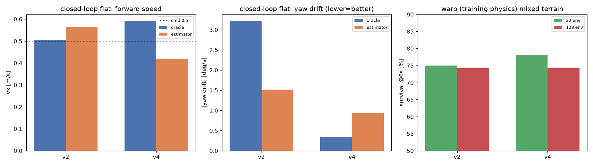

# Go2 v4: 混合地形训练 —— 结果与结论

> 配方: **v2 + 混合地形** (单变量 = 地形)。速度观测回退到 v2 设置 (白噪声 0.05,
> 无 bias/漂移/延迟 —— v3 的强误差注入是负结果, 见 docs/go2-v3-obs-vel-error.md §8)。
> 地形: 3x3 patch 混合地形 (台阶/斜坡/起伏/波/方块/Perlin), 12m x 12m, **n=128
> (9.4cm 格距, warp 的 geom-hfield 50 接触上限约束)**, 见 docs/go2-terrain-survey.md。
>
> 训练 40,550,400 步 (2560 env, 硬接触); best eval_reward **1152.5** @37.85M;
> 接触/数值异常 0 (hfield overflow / broadphase / NaN 全 0)。
> 产物: `policies/go2_walk_v4.pkl` (sha256 `ec8b4caf76801e2b3783...`),
> `models/policies/go2_walk_v4.npz` (部署框架, 导出等价性 PASS, profile `go2_v4`)。



---

## 1. 平地步态: v4 明确更好

训练 XML (position 执行器), 16 轮 x 15s, cmd vx=0.5:

| 指标 | v2 (旧地形) | **v4 (混合地形)** |
|---|---|---|
| 存活率 | 100% | **100%** |
| 实际 vx | 0.510 | 0.516 |
| 跟踪误差 | 0.073 | 0.101 |
| 躯干 z | 0.276 | 0.277 |
| roll mean (max) | −1.44° (12.4°) | **+0.70° (11.1°)** |
| pitch mean (max) | −0.17° (11.2°) | +3.45° (17.0°) |
| trot 占比 / 判为 trot 的轮 | 42% / **0%** | 55% / **100%** |
| 对角占空比 A/B | 0.52 / 0.31 (**1.68x**) | 0.53 / 0.39 (**1.38x**) |
| 足端滑移 | 0.392 m/s | **0.337 m/s** |
| tau 均值 (峰值) | 5.56 (30.1) | 6.01 (28.6) N·m |
| 前进距离 | 7.11 m | 7.15 m |

部署模型闭环 (ROS2 框架, 平地 15s, cmd vx=0.5, 同一 kp/kd/模型):

| 组 | 机体 vx | |yaw drift| | tilt RMS | z |
|---|---|---|---|---|
| v2 + oracle | 0.505 | **3.22 deg/s** | 3.01° | 0.289 |
| **v4 + oracle** | 0.592 | **0.35 deg/s** | 6.25° | 0.274 |
| v2 + estimator | 0.565 | 1.52 | 6.03 | 0.180 |
| **v4 + estimator** | 0.420 | **0.93** | 5.98 | 0.205 |

**收益**: 偏航漂移几乎消除 (oracle 3.22 -> 0.35 deg/s, estimator 1.52 -> 0.93),
首次出现 100% 判定 trot, 对角不平衡 1.68 -> 1.38, 滑移降低, 平地 100% 存活。
**代价**: 躯干倾角振荡变大 (3.0 -> 6.2° RMS)、oracle 下超速 +18% (0.59 vs cmd 0.5)、
estimator 下偏慢 (-16%)。是"更动态但走得更直"的步态。

## 2. 地形: 训练物理里没有提升

warp (训练物理) 随机出生 32/128 env x 300 步 (6s), 同一张混合地形:

| 组 | 32 env 存活 | 128 env 存活 | 存活期 vx |
|---|---|---|---|
| v4 (混合地形训练) | 78.1% | **74.2%** (95/128) | 0.487 |
| v2 (旧地形训练) | 75.0% | **74.2%** (95/128) | 0.484 |
| v4 在旧地形 | 71.9% | — | 0.495 |
| v2 在旧地形 | 71.9% | — | 0.495 |

128 env 下两者**完全相同** (74.2%)。说明:
1. 混合地形训练**没有**带来地形鲁棒性提升 —— 部分原因是这张混合图本身比旧地形**更缓**
   (90% 区域 <=9.3cm, 而旧地形有 30cm 楼梯); 训练它主要是让步态在多样地面上更规整。
2. v2 在混合地形上同样是 74.2% —— 旧地形训练的策略泛化到新地形没掉, 反过来也说明
   当前瓶颈不是"地形多样性不足"。

## 3. CPU MuJoCo 的地形评测依旧不可用 (头号风险)

CPU MuJoCo (6s x 16, 混合地形): v4 存活 50.0% / vx 0.131; v2 68.8% / vx 0.050。
而 warp 里两者都是 ~74% / vx 0.48 —— **同一个策略、同一份 XML, 地形 vx 差 3-4 倍**。

本次还排除了一个可能原因: **求解器迭代数**。
`--solver env` (20/10, 训练同款) 与 `--solver cpu` (100/50) 对比:

| 策略 | 100/50 | 20/10 |
|---|---|---|
| v4 vx / 存活 | 0.131 / 50.0% | 0.192 / 37.5% |
| v2 vx / 存活 | 0.050 / 68.8% | 0.128 / 18.8% |

迭代数改变有影响, 但**两档都远达不到 warp 的 0.48 m/s**, 且 20/10 在 CPU 上更差
(Go1 上"20/10 == 100/50"的结论在 Go2 地形上不成立)。所以差异来自更底层的 hfield 接触
实现 (warp 逐格三角 prism vs CPU 的 hfield 接触生成), 不是参数问题。

**结论**: 地形能力目前只能在 warp (训练物理) 里验收; 真机/CPU 部署前必须先解决这个
sim2sim gap (它是 docs/go2-delivery.md 的 R1)。

## 4. 建议

1. **平地/城市/室内场景**: 把 v4 作为默认策略 (偏航漂移、trot、滑移都更好);
   在部署框架里用 `--policy-profile go2_v4` 即可切换, v2 默认档不受影响。
2. **地形场景**: v4 与 v2 在训练物理里等价; 若目标是更强地形, 需要 **v5**: 做"更难的地形
   mix" (更多台阶/更陡坡/更少平地, 仍然 n=128), 并接受只在 warp 里验收。
3. **优先级最高的其实是 R1** (warp <-> CPU hfield 接触差异): 不解决它, 任何地形模型的
   真机部署都没有可信的验收依据。

## 5. 复现

```bash
cd mjx-go1-getup
# 训练 (v2 配方 + 混合地形; 注意 n=128 的地形)
bash sim/start_go2_v4_train.sh 40000000

# CPU 评测套件 (flat / 混合地形 / 旧地形 / 部署模型)
bash sim/eval_v4_vs_v2.sh

# warp (训练物理) 地形评测: 随机出生 128 env x 300 步
XLA_PYTHON_CLIENT_PREALLOCATE=false XLA_PYTHON_CLIENT_MEM_FRACTION=0.4 \
  /home/tc63/mujoco/.venv/bin/python sim/probe_go2_warp_eval.py \
  --policy policies/go2_walk_v4.pkl --envs 128 --steps 300 --spawn random \
  --cmd 0.5 0 0 --foot-contact hard \
  --terrain_xml models/go2/scene_mjx_terrain_mix.xml

# 部署框架闭环 A/B (v2/v4 x oracle/estimator)
cd ../mjx-go2-mujoco2ros2 && bash scripts/eval_v4_vs_v2.sh
```
