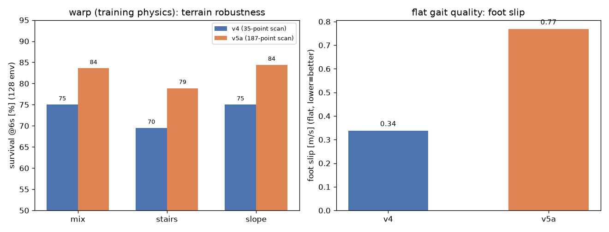

# Go2 v5: 地形课程 + 大扫描 —— 结果与结论

> v5 = **高度扫描从 35 点扩到 187 点 (17x11, 1.6x1.0m, 0.1m 间距)** + **两段式地形课程**
> (A: mix 20M -> B: 台阶/斜坡加权硬地形 20M). 硬接触, 2560 env.
> 训练异常: 0 (hfield 溢出 / broadphase / NaN 全 0).
> 产物: v5a-best (20M, 推荐候选) / v5b-best (40M) / v5.pkl (最终参数, 劣于 best, 不推荐).



---

## 1. 训练

| 段 | 步数 | 地形 | best eval_reward |
|---|---|---|---|
| A | 20.07M | mix (n=128) | 757.4 @20.07M |
| B | +20M (累计 40.07M) | v5 台阶/斜坡加权 (硬度1.5, 台阶<=24cm) | 832.7 @31.47M (累计) |

fps ~4850-4917; 两段均正常完成.

## 2. 评测协议

* **warp (训练物理), 随机出生, 128 env x 300 步 (6s)** —— 这是唯一可信的地形口径
  (CPU MuJoCo 的 hfield 接触与 warp 不一致, 见 docs/go2-delivery.md R1);
* 单类型地形图: stairs_only / slope_only / rough_only / boxes_only / wave_only / perlin_only
  (由 gen_terrain_go2_mix.py 生成, n=128);
* 平地: CPU MuJoCo, 16 轮 x 15s.

## 3. 结果

### 3.1 地形 (warp, 128 env, random spawn, 6s 存活率)

| 地形 | v4 (35 点) | **v5a-best (187 点, 20M)** | v5b-best (187 点 + 硬地形段) |
|---|---|---|---|
| mix | 75.0% | **83.6%** | 81.2% (32env) |
| stairs_only | 69.5% | **78.9%** | 77.3% |
| slope_only | 75.0% | **84.4%** | 77.3% |
| boxes_only | 46.9~53.1% (32env) | 56.2% (32env) | **59.4%** (32env) |

**结论 1: 扫描从 35 点 -> 187 点是有效杠杆** —— mix/stairs/slope 一致 +9pp 左右
(n=128, 三个地形同向, 不是噪声).
**结论 2: 硬地形课程段 (Stage B) 没有额外收益**, 在 stairs/slope 上甚至比 v5a 低 1.6/7.1pp;
它只在 boxes 上略好 (+3pp, 32env). 说明**当前瓶颈不是"地形不够难/课程不够"**, 而是感知与训练量.
**结论 3: 最终 pkl 劣于 best 检查点** (v5 最终参数 mix 75.0%, best 81.2%) —— 用 best, 不用 final.

### 3.2 平地 (CPU, 16x15s)

| 指标 | v4 | v5a-best | v5b-best |
|---|---|---|---|
| 存活 | 100% | 100% | 100% |
| vx (cmd 0.5) | 0.516 | 0.502 | 0.517 |
| 跟踪误差 | 0.101 | 0.096 | 0.099 |
| 躯干 z | 0.277 | 0.266 | 0.268 |
| **足端滑移** | **0.337** | **0.768** | 0.586 |
| 判为 trot 的轮 | **100%** | 0% | 0% |
| 对角占空比 A/B | 1.38x | 1.43x | 1.68x |

**结论 4: 大扫描模型的平地步态质量下降** (滑移 0.34 -> 0.77 m/s, trot 判定 0%).
可能原因: ① 20M 步不足 (v4 是 40M); ② 128x128 MLP 对 243 维输入的容量偏小
(legged_gym 用 512-256-128); ③ 扫描特征占 obs 77%, 网络把容量让给了地形而步态塑形变弱.
-> v5c 正在验证"是否欠训" (v5a 续 +20M, ETA ~19:45).

## 4. 对"要不要上更高级训练算法"的回答 (基于本轮证据)

1. **课程学习已经上了**, 但证据显示: 硬地形课程段**不是**当前瓶颈; 感知 (扫描密度) 才是,
   这一项已经修好 (+9pp). 课程仍有价值, 但应该用**更温和**的过渡 (mix -> mix_hard),
   而不是一步跳到台阶/斜坡加权硬图.
2. **真正需要更高阶算法的地方, 受当前框架限制**:
   * brax + MJX warp 是**单模型 vmap**, 没有 per-env 模型参数 -> **无法做逐环境动力学随机化**
     (摩擦/质量/电机强度) 和 **per-env 地形课程**; 这两项要做得换 mjlab(torch) 或 IsaacLab.
   * **对称性数据增强**需要自定义 PPO 更新 (brax 无此功能), 属于中等工程量、风险可控.
   * 可实现的"轻量 DR": 动作延迟 (0-20ms)、电机增益缩放、更强推挤、扫描丢点/噪声、
     指令课程 —— 都在 env 侧, 不需要改框架.
3. **优先级建议 (v6)**:
   a. 先把 v5a 训满 (v5c, 进行中) + 网络加大到 256x256 (容量);
   b. 轻量 DR (延迟/增益/丢点/推挤) —— 直接对应 sim2real;
   c. 温和课程 (mix -> mix_hard), 替代现在的硬课程;
   d. 若这些仍不够, 再考虑: 对称性增强 (自定义 PPO) 或迁移 mjlab (成本高).

## 5. 复现

```bash
cd mjx-go1-getup
# 生成单类型地形 (评测用)
for p in mix mix_hard v5 stairs_only slope_only rough_only boxes_only wave_only perlin_only; do
  /home/tc63/mujoco/.venv/bin/python sim/gen_terrain_go2_mix.py --n 128 --preset $p --seed 1 --out_prefix terrain_$p
done
# v5 两段课程
bash sim/run_go2_v5_curriculum.sh
# 用 best 检查点跑 128-env 地形评测 (注意 v5 需要扫描参数)
CK=$(readlink -f models/go2_v5a_logs/checkpoints/best)
XLA_PYTHON_CLIENT_PREALLOCATE=false XLA_PYTHON_CLIENT_MEM_FRACTION=0.4 \
  /home/tc63/mujoco/.venv/bin/python sim/probe_go2_warp_eval.py \
  --policy "$CK" --envs 128 --steps 300 --spawn random --cmd 0.5 0 0 --foot-contact hard \
  --terrain_xml models/go2/scene_mjx_terrain_stairs_only.xml \
  --scan_nx 17 --scan_ny 11 --scan_x -0.4 1.2 --scan_y -0.5 0.5
```
