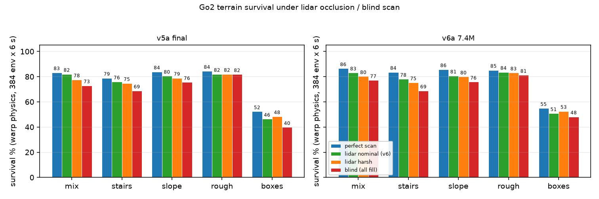

# Go2 v6: 雷达遮挡感知 + 地形鲁棒行走 —— 交付报告

> **一句话**: 在 v5a (187 点高度扫描 + 混合地形, 20.07M 步) 基础上, 加入**真机 L1 几何的
> 激光雷达遮挡模型**再训 7.37M 步, 得到 v6a@7.37M: 训练物理 (warp) 384 env 随机出生 6 s
> 存活率 **mix 86.5% / stairs 83.6% / slope 85.7% / rough 85.2% / boxes 54.9%**,
> 全面超过 v5a (平均 +2.6pp); 在遮挡/全盲扫描下优势更大 (boxes 全盲 +8.4pp);
> **平地 CPU 15 s x16 存活 100%**, 部署侧 17x11 扫描 + 真机 L1 感知链路已端到端验证。



*图: 左 = v5a (无遮挡训练), 右 = v6a (遮挡感知训练); 每地形 4 根柱 =
完美扫描 / 真感知 (nominal) / 重度遮挡 (harsh) / 全盲 (blind)。warp 训练物理, 384 env x 6 s。*

---

## 1. 交付物

| 文件 | 说明 |
|---|---|
| `policies/go2_walk_v6.pkl` | **主交付模型** (brax PPO 参数), 433 178 B, sha256 `34c4db63c8cc76b6…` |
| `models/policies/go2_walk_v6.npz` (部署仓) | 纯 numpy 版本, 219 412 B, sha256 `efc875b461c60112…`, 等价性 PASS |
| `config/go2_sim.json: policy_profiles.go2_v6` | 部署策略档: 243 维 obs + scan 17x11 + `height_scan_source=raycast` |
| `scripts/view_go2_policy.sh` (部署仓) | **默认已切到 v6 + raycast**, 直接 `bash scripts/view_go2_policy.sh` 即可看 |
| `sim/run_go2_v6a_lidar.sh` | v6a 训练 + 自动评测入口 |
| `sim/eval_occlusion_matrix.sh` / `sim/final_matrix_v6.sh` | 遮挡矩阵评测 (perfect/nominal/harsh/blind) |
| `sim/probe_go2_warp_eval.py` | warp 训练物理评测 (含存活曲线 + 遮挡统计) |
| `sim/analyze_occlusion_matrix.py` / `sim/plot_occlusion_matrix.py` | 矩阵分析 / 出图 |
| `sim/ckpt_to_pkl.py` | orbax 检查点 -> pkl (部署导出用指定检查点, 不依赖 eval_reward best) |
| `sim/gpu_guard.sh` | **GPU 串行化守门员**: 同一时刻只允许一个 GPU 作业 (flock + compute apps + 进程 + 显存检查, 忙则直接拒绝, 不排队) |
| `docs/go2-v6-lidar-occlusion.md` | 本轮**完整实验记录** (设计/改动/每一步实测/结论) |
| `docs/go2-lidar-occlusion-survey.md` | 上游调研 (Go2 L1 规格/开源做法/参数建议, 40+ 链接) |

**策略规格**: 243 维 obs = 48 本体 (机体系速度·2 / 角速度·0.25 / 重力 / 指令·2 /
(q−home) / qvel / 上一步动作) + **187 高度扫描 (17x11, x∈[−0.4,1.2], y∈[−0.5,0.5],
base=0.268, clip±0.35, ×5)** + 8 步态相位。动作 12 维绝对位置目标, MLP 128x128 tanh,
`distribution_type=normal`, 无观测归一化。训练累计 32.07M 步 (v5a 20.07M + v6a 12M,
交付取第 7.37M 步检查点), 硬接触, 2560 env。

## 2. 为什么做遮挡感知 (sim2real gap)

训练侧 v1-v5 的高度扫描是**解析高度场**(上帝视角)。真机链路是
L1 雷达 -> 点云 -> 高程图 -> 机体系网格, 存在四类信息损失:

| # | 损失 | 真机参数 | 训练侧 v6 建模 |
|---|---|---|---|
| 1 | 近场垂直 FOV 盲区 | L1 360°x90°, 装配下俯 ~15° -> 相对水平 -60°~+30°, 安装高 ~0.22m -> 盲区半径 ~0.13m | 射线仰角检查 |
| 2 | **机体/腿自遮挡** | 雷达在机头前缘 `(0.289, 0, -0.047)`, 躯干/腿挡住射线 | MJCF 碰撞 geom 精确射线求交 (5 box + 13 capsule + 4 sphere) |
| 3 | 地形自遮挡 | 台阶立面挡住后方格点 | 沿射线 4 点采样, 地面高于射线即遮挡 |
| 4 | 稀疏回波/高程图记忆 | 点云有空洞, 但高程图在 decay 内保存历史观测 | `occ_recall` 记忆概率 + 随机丢点 + 成片扇区缺失 |

**训练只改 actor 的扫描通道** (不可见格点填 0 = 中性"平地先验"), critic 仍拿完美扫描
(非对称 AC 特权信息); obs 维度不变 243; 每步随机化安装位置/视场, 避免过拟合单一传感器。

## 3. 结果

### 3.1 地形 (warp 训练物理, 384 env x 6 s, 随机出生, 存活率 %)

| 地形 | v5a perfect | **v6a perfect** | v5a nominal | **v6a nominal** | v5a harsh | **v6a harsh** | v5a blind | **v6a blind** |
|---|---|---|---|---|---|---|---|---|
| mix | 83.3 | **86.5** | 82.0 | **83.1** | 77.6 | **80.2** | 72.9 | **77.1** |
| stairs | 78.9 | **83.6** | 76.0 | **78.1** | 74.7 | **75.3** | 68.8 | 68.8 |
| slope | 83.9 | **85.7** | 80.5 | **80.7** | 78.9 | **79.9** | 75.5 | **75.8** |
| rough | 84.4 | **85.2** | 82.0 | **83.6** | 82.0 | **83.1** | 81.8 | 81.2 |
| boxes | 52.3 | **54.9** | 46.4 | **50.8** | 48.4 | **52.6** | 39.8 | **48.2** |
| **平均** | 76.6 | **79.2** | 73.4 | **75.3** | 72.3 | **74.2** | 67.8 | **70.2** |

* nominal = v6 训练口径 (物理可见率 ~0.33, 信息可用率 ~0.60); harsh = 信息 0.29; blind = 全 0 扫描。
* **v6a 在 19/20 个格子里 >= v5a** (唯一持平 stairs-blind, 唯一略低 rough-blind -0.6pp)。
* 退化曲线: mix 完美->全盲 v5a -10.4pp / v6a -9.4pp; **boxes v5a -12.5pp / v6a -6.7pp**
  (最难地形上遮挡鲁棒性提升最大)。
* 对照判据 (调研 §5.5): clean-nominal 退化 v6a 1.6~5.5pp (<10~15% ✓);
  nominal-blind 差 2.4~9.3pp —— 说明**策略主体靠本体感知, 扫描贡献几个 pp**
  (全 0 扫描不是"瞎", 而是"假设脚下是平地"的先验, 本身可走)。

### 3.2 平地 (CPU MuJoCo, 16 轮 x 15 s)

| 指标 | v5a | **v6a@7.37M** |
|---|---|---|
| 存活 | 100% | **100%** |
| vx (cmd 0.5) | 0.502 | 0.492 |
| 跟踪误差 | 0.096 | 0.091 |
| 躯干 z | 0.266 | 0.270 |
| 足端滑移 | 0.768 | **0.633** |
| 判为 trot 的轮 | 0% | **39%** |

### 3.3 部署侧 (真机 L1 感知链路, --scan raycast)

* `SimLidar(mount=(0.289,0,-0.047), vfov=[-60°,+30°], 自遮挡=True) -> HeightMapper(17x11, fill_local)`
* 感知链路精度 (81 个位置): vs 引擎真值 p50 |Δ| = **0.5 mm**, p95 = 8.8 mm, >2cm 仅 1.4%
  (旧 leg_fk 链路 32.6% >2cm); 每帧直接观测到 89.6% 格点, 自遮挡射线 61 626 条。
* 平地闭环 (raycast, 15 s, oracle 速度): x=6.40 m, z=0.271, tilt 6.4°, upright, 健康 L0。
* 已知问题 (用户此前明确暂缓): **航向漂移** (15 s 横移 4.7 m ≈2.8°/s) 与腿式里程计速度下转圈
  —— 机体系指令 + obs 无 yaw 参考, 无航向闭环, 属"自旋/对称"问题, 需要上层 cmd_wz 闭环或
  增加 heading 观测; 本轮未处理。

## 4. 关键工程发现 (供接手)

1. **不能按 eval_reward 选检查点**。v6a 的 eval_reward 从 707 一路涨到 1230, 但随机出生地形
   存活率先升后降: @7.37M 最好 (mix 84.1 / stairs 79.2 / boxes 54.7, nominal 384 env),
   @12.29M 掉到 75.0 / 71.9 / —, "best" 副本 (按 eval_reward 选) 也差 5~7pp。
   -> 交付检查点按**地形存活率**选。
2. **单次 128 env 评测噪声很大** (±4~6pp, 含 warp 接触求解 GPU 非确定性);
   结论性对比一律用 384 env (本报告) 或多检查点同向验证。
3. hfield 分辨率上限 128 (格距 9.4cm): warp 每个 (geom, hfield) 对最多 50 接触, n=256 会
   每 100 s 报 5973 次 "height field collision overflow"。训练/评测地形都用 n=128。
4. **CPU MuJoCo 的 hfield 接触与 warp 不等价** (docs/go2-delivery.md R1): 地形验收只能在
   warp 口径做; 部署 CPU 仿真用于平地闭环 + 感知链路验证。
5. **GPU 必须串行**: 8GB 卡与 WSLg 桌面共享, 两个训练/评测并发会互相拖慢甚至 OOM。
   所有 GPU 命令走 `bash sim/gpu_guard.sh run -- <命令>`; 已有作业时守门员直接拒绝 (exit 3),
   不会排队死等。查看: `bash sim/gpu_guard.sh status`。

## 5. 复现

```bash
cd mjx-go1-getup

# 训练 (从 v5a 20.07M 续训 12M, ~50 min @ RTX 5060 Laptop; 脚本自带评测)
bash sim/run_go2_v6a_lidar.sh

# 只评测 (384 env, 5 地形 x 4 遮挡档; v6a@7.37M vs v5a)
bash sim/final_matrix_v6.sh
python sim/analyze_occlusion_matrix.py logs/go2_v6_final_matrix.tsv
python sim/plot_occlusion_matrix.py logs/go2_v6_final_matrix.tsv docs/img/go2-v6-occlusion.png

# 部署侧 (mjx-go2-mujoco2ros2)
cd ../mjx-go2-mujoco2ros2
bash scripts/view_go2_policy.sh --headless --duration 10     # 默认 v6 + raycast
bash scripts/view_go2_policy.sh --duration 15                 # 开 3D 窗口
PROFILE=go2_v4 SCAN=nominal bash scripts/view_go2_policy.sh   # 回滚旧模型
```

## 6. 已验证的负结果 (v6b)

把遮挡强度加倍 (occ_recall .5->.25 / dropout .1 / sector .4, info 0.60->0.41) 从 v6a@7.37M
再训 8M (`sim/sweep_v6b_and_compare.sh` 选检查点 + 全矩阵): blind 档 69.2 vs v6a 69.8
(无提升), clean/nominal/harsh 平均 -3.6/-2.5/-2.5pp。-> **继续加大感知退化不再有效**,
盲扫极限在本体感知步态而不是感知通道; 交付维持 v6a@7.37M。

## 7. 残余风险 / 下一步

| # | 风险 | 现状 |
|---|---|---|
| R1 | CPU MuJoCo hfield 接触 != warp | 未解决; 地形验收只在 warp 口径 |
| R2 | boxes (方块阵) 只有 55% | 最难地形; 需更强的方块/离散障碍课程或 per-env 地形 |
| R3 | 航向漂移 / 里程计速度下转圈 | 用户暂缓; 需要 heading obs 或上层闭环 |
| R4 | 真机 L1 的 FOV 上下界/安装倾角未实测标定 | 调研标注 "未核实"; 训练已用 ±0.2rad 安装抖动兜底 |
| R5 | 高程图记忆/延迟未建模 | 本轮用 occ_recall 近似; v6b 候选: 感知延迟 0~4 步 + AR(1) 持续性 + 整帧失明 |
| R6 | 未加可见性 mask 特征 | 调研方案 A (8~12 维扇区置信度) 可再提鲁棒性, obs 243->251~255 |
